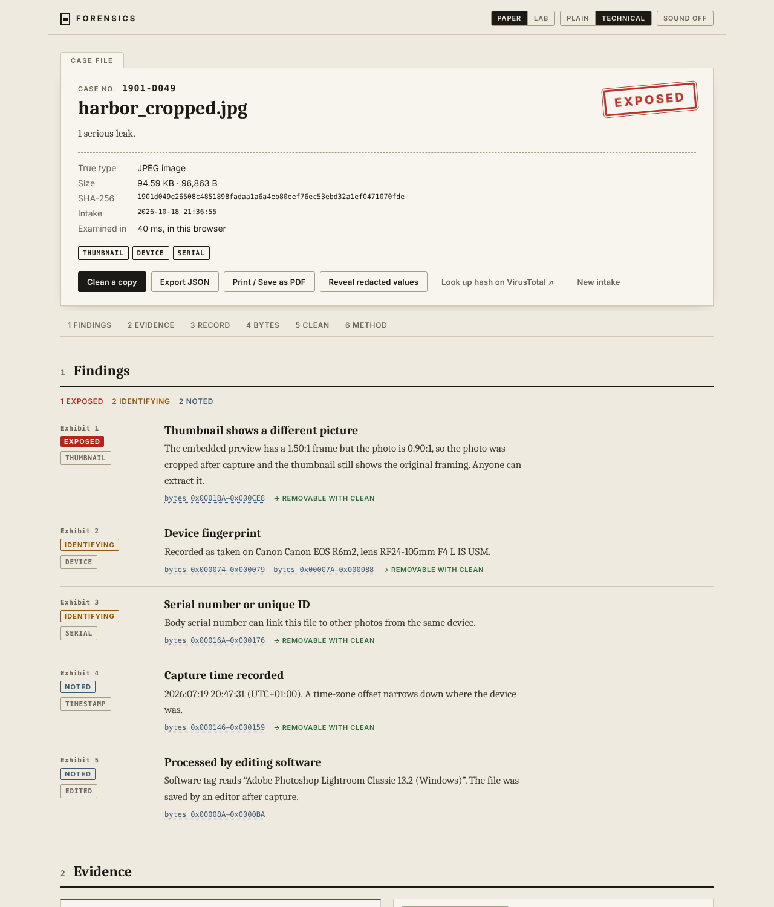

# Forensics

**A privacy X-ray for every file, and the fix.** Drop a photo, video, PDF, Office document, archive or executable. Forensics opens a case on it: where it was made, who touched it, what earlier versions it still carries, and what is hidden inside. Then it strips the leaks without re-encoding a pixel. Everything runs in your browser, in a Web Worker. Nothing is uploaded.



## What it finds

| Leak | How it's found |
|---|---|
| **Thumbnail shows what was cropped** | The EXIF IFD1 preview is decoded and compared with the photo (aspect ratio + 64-bit difference hash). Editors often leave it untouched. |
| **GPS in photos** | Hand-written TIFF/EXIF engine, used for JPEG (APP1), PNG (eXIf), HEIC/HEIF (EXIF item via `iinf`/`iloc`), WebP, TIFF and DNG. XMP and IPTC too. |
| **GPS in phone videos** | ISO-BMFF box walker: QuickTime `©xyz`, Apple/Android `mdta` keys (`com.apple.quicktime.location.ISO6709`), `mvhd` recording time. |
| **Deleted text in Word files** | DOCX/XLSX/PPTX: authors, last-modified-by, company, template paths, comments, tracked changes (`w:delText` is recovered word for word), hidden text, speaker notes, hidden sheets, macros. |
| **Earlier PDF versions** | Incremental updates are split at each `%%EOF`; every earlier version can be downloaded intact. Info per revision (latest wins), XMP, JavaScript/Launch/OpenAction, invisible text (`3 Tr`), compressed object streams. |
| **Disguised executables** | Magic bytes vs extension. PE headers: build time, packed sections (per-section entropy), Authenticode presence, and the debug PDB path, which often contains a Windows username. |
| **Hidden payloads** | Data after JPEG EOI / PNG IEND / BMP size, ZIP slip paths, credential-like strings (ASCII and UTF-16) anywhere in the bytes. |
| **LSB steganography** | Chi-square attack (Westfeld–Pfitzmann) and RS analysis (Fridrich et al.) on exact pixels from a built-in PNG/BMP decoder, plus a bit-plane viewer. Reported as "consistent with", never as proof. |
| **Tampering hints** | Error level analysis heatmap and a JPEG quantisation-table fingerprint (IJG quality estimate, standard vs custom tables). |

Every finding links to the byte range that proves it, shown in a virtualised, structure-aware hex viewer (segment/chunk/box/IFD tree, inspector, go-to-offset). A Hilbert-curve byte-plot and an entropy-over-offset graph show the whole file at once.

## The fix

**Clean a copy** removes metadata without re-encoding and then re-examines the result, so you see a before/after table:

- **JPEG**: drops EXIF/XMP/IPTC/comments/vendor APP segments and trailing data; keeps scan data byte-identical, ICC profile, and orientation (as a one-tag EXIF block).
- **PNG**: drops text, eXIf, tIME and private chunks; keeps pixels and colour chunks. **WebP**: drops EXIF/XMP chunks and fixes the VP8X flags.
- **DOCX/XLSX/PPTX**: blanks document properties and the saved preview; every other part is copied with its original compressed bytes. Comments and tracked changes are content, so they're **reported, not removed**.
- **PDF**: blanks Info values and XMP in place with same-length padding (xref offsets stay valid) across all revisions. Metadata inside compressed object streams is reported as not cleaned.
- **MP4/MOV**: location atoms become `free` padding of the same size. **HEIC**: the EXIF item is zeroed in place. **TIFF/DNG**: sensitive tag values are blanked in place.

Drop several files or a folder for **batch** mode: a worker pool examines them in parallel, and *Clean all* produces a ZIP of cleaned copies plus `summary.json` and `summary.html`. Files that can't be cleaned are listed in the summary, not silently copied.

Cases export as JSON or print as a report (*Print / Save as PDF*). Personal values sit behind redaction bars until you reveal them, so a case can be screen-shared safely. The optional VirusTotal link sends only the SHA-256.

## Evidence samples

Nine synthetic samples, one per headline leak, are built by `npm run samples` (real JPEGs rendered in headless Chromium, metadata spliced in with the project's own writers). Open one at `/#sample=harbor_cropped.jpg`. The phone-video sample is a metadata-only container with no frames. The people, places and numbers in the samples are invented.

## Privacy model

- The page's CSP only allows its own origin. The one exception is OpenStreetMap tiles, fetched only after you click *Show on map*.
- Files are passed to the worker as `Blob`s and read with `Blob.slice`, so large files never sit on the main thread.
- After the first visit a service worker caches the app and samples, so it works offline.

## Develop

```bash
npm install
npm run dev          # esbuild watch + serve on :3000
npm run check        # typecheck + unit tests
npm run test:e2e     # build, then Playwright against dist/
npm run build        # dist/ (zero runtime dependencies)
```

TypeScript, bundled by esbuild into `dist/app.js`, `dist/worker.js` and `dist/sw.js`. Dev dependencies only: TypeScript, esbuild, Vitest, Playwright. **84 tests**: 73 Vitest unit tests (parsers, sanitizers, steganalysis, the sample corpus) and 11 Playwright end-to-end tests (thumbnail comparison, redaction, byte jumps, cleaning, bit planes, ELA, batch ZIP, a 64 MB file without blocking the UI, mobile layout, no off-origin requests).

```
src/core       types, magic bytes, analysis pipeline, verdict
src/parsers    tiff jpeg png pdf zip ooxml isobmff pe id3 riff bmp xmp
src/analysis   streaming scanner (SHA-256, entropy, byte-plot, strings), stego, ELA, thumbnail, DQT
src/sanitize   lossless cleaners + per-format plan
src/worker     worker entry and message protocol
src/ui         case file, hex viewer, plates, intake, batch
public         index.html, CSS (paper + lab themes), icons, manifest
samples        evidence samples (also the test corpus)
```

## Limits

- Authenticode signatures are detected, not verified (no certificate chain in the browser).
- Structure parsing holds files up to 96 MB in worker memory; larger files are parsed from their first 32 MB (PDFs: head and tail) while hash, entropy and byte-plot still cover every byte. Strings come from the first 16 MB and last 1 MB.
- Steganalysis needs 8-bit truecolour or greyscale PNG/BMP, non-interlaced, up to 40 megapixels.
- ELA and steganalysis are statistical hints. Neither proves tampering or hidden data.
- HEIC cleaning zeroes the EXIF item. It does not rebuild the item table.

## License

MIT. See [LICENSE](LICENSE).
